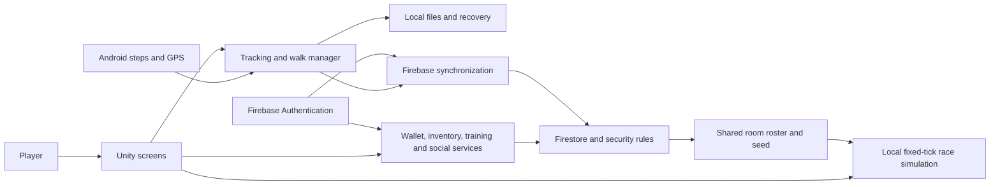

# Walking Dog — Project Documentation

**Status:** First draft for team review.

**Source baseline:** `Development-JM`, commit `cdc8ebc`.

**Prepared:** October 19, 2026.
**Working title:** Walking Dog; official submission title pending confirmation.

This document describes the implementation available in the repository. Proposed
project framing is labelled explicitly. Current runtime results, team information
and screenshots remain pending where indicated.

## 1. Project overview

### 1.1 Introduction

Walking Dog is a mobile walking game developed in Unity. It connects recorded
physical activity to points, collectible collars and virtual dog progression.
Players can record GPS walks, claim qualifying territory, train their dog and
enter automatic races. Friends, rankings and optional activity sharing provide
ways to compare progress and interact with other players.

The main gameplay loop is:

**Walk → earn points → train a dog or collect collars → race → continue walking.**

Territory exploration and social comparison provide additional activities around
this loop. The implemented mobile integrations focus on Android.

### 1.2 Background and project motivation

**Proposed framing:** Walking Dog explores how a mobile game can make walking
more engaging by connecting activity to visible virtual progression. Step totals
and GPS routes become inputs to rewards, collection and competition, giving
players several reasons to return to the game.

This is a suggested explanation of the design, not a measured finding about
players or a claim that the game improves health. The team's original motivation
and any organization-specific problem statement still need confirmation.

### 1.3 Objectives

**Proposed general objective:** Develop an Android walking game that combines
activity tracking with virtual dog progression and social gameplay.

Specific objectives reflected in the implementation are to:

1. Record steps independently of a manually started territory walk.
2. Record GPS walk sessions, preserve their history and recover interrupted walks.
3. Convert tracked steps into points with persistent accounting.
4. Support collar collection, equipment and paid dog stat training.
5. Provide practice races and shared race rooms.
6. Provide rankings, friend management and optional follower access to walks.
7. Keep account-owned progress separate and apply access rules to cloud data.

### 1.4 Intended users

**Proposed audience:** Android users interested in walking, virtual dog games,
collectibles and casual competition. The project has no documented confirmed age
range, participant population or accessibility evaluation. These details should
be agreed with the team before inclusion in a formal submission.

## 2. Scope and requirements

### 2.1 Implemented scope

| ID | Requirement | Primary implementation |
| --- | --- | --- |
| FR-01 | Authenticate players using email/password or Android Google sign-in. | `FirebaseLoginManager`, `LoginUIManager` |
| FR-02 | Record cumulative steps and synchronize point earnings. | `ContinuousSteps`, `FirebaseContinuousStepsStore` |
| FR-03 | Start, finish, save and recover GPS walks. | `StepCountAndGpsManager`, `WalkRecoveryUI`, `LocalWalkRepository` |
| FR-04 | Evaluate eligible routes for territory claims. | `TerritoryCapture`, `TerritoryGeometry`, `TerritoryService` |
| FR-05 | Spend points on collar pulls and claim earned milestone rolls. | `GachaManager`, `PointsWallet` |
| FR-06 | Persist unlocked collars and equip an owned item. | `CollarInventoryStore`, `CollarInventoryUI` |
| FR-07 | Train Speed, Stamina and Acceleration using wallet points. | `DogStats`, `FirebaseDogTrainingStore` |
| FR-08 | Run practice races and create/join shared race rooms. | `DogGameScreens`, `DogRaceSimulation`, `FirebaseRaceLobbyService` |
| FR-09 | Show global and accepted-friend rankings. | `FirebaseLeaderboardService`, `LeaderboardPanelUI` |
| FR-10 | Manage following and opt-in access to walk activity. | `FirebaseSocialService`, `SocialPanelUI`, `SocialRouteSync` |

### 2.2 Quality goals

The implementation includes local saves, retryable synchronization, transaction
receipts, account-change checks and request error states. These mechanisms aim
to preserve progress and prevent stale results from being displayed under a
different account. Their presence does not replace end-to-end verification.

**Proposed acceptance goals:** clear loading/error feedback, readable controls
on supported phone sizes, reliable recovery after interruptions, correct access
boundaries and consistent race results across participating phones. Device
support, performance targets and acceptable battery use remain to be defined.

### 2.3 Scope boundaries

The current game does not establish health outcomes or provide medical activity
measurement. Continuous steps are not an imported all-time health total. The
project does not promise tracking after force-stop. Races currently have no entry
fees or rewards. This document does not assert iOS support, a store release,
production deployment status or completed user evaluation.

## 3. Game design and mechanics

### 3.1 Continuous activity and points

The main step count represents the current account's cumulative steps recorded
on the installation by this tracker. It is not a daily counter. Starting or
finishing a territory walk does not reset it.

Every ten newly credited steps earn one point. Remainders carry across updates,
restarts and walks; account-wide aggregation also carries remainders across
installation streams. For example, 105 + 208 + 47 steps total 360 steps and earn
36 points. New territory-walk steps already belong to continuous activity and
must not earn a second reward through the walk summary.

Signed-out activity stays local rather than automatically transferring to an
account. Offline activity can remain saved for later synchronization. A displayed
pending wallet balance should not be interpreted as confirmed new earnings.

### 3.2 GPS walks and territory

A territory walk records its own route, distance, duration and steps. GPS quality
and continuity determine whether its route qualifies for territory. The documented
rules require a signed-in walk and accepted GPS accuracy of 10 metres or better.

| Rule | Current documented threshold |
| --- | --- |
| Minimum trail length | 50 metres |
| Trail buffer | 5 projected metres on each side |
| Minimum loop length | 200 metres |
| Minimum enclosed area | 2,500 square metres |
| Maximum loop closing gap | 30 metres |

An eligible trail claims a corridor; a qualifying closed loop also claims its
interior. Intersecting or retraced loop edges can prevent interior filling while
leaving a valid corridor claim. Overlaps do not count the same owned land twice.
The buffer uses projected coordinates, so its ground width varies by latitude.
See [territory claiming](territory-claiming.md) for geometry limits and migration.

### 3.3 Collar collection and equipment

The saved gameplay scene configures a paid collar pull at **100 points**, with
Bronze **70%**, Silver **25%** and Gold **5%** tier probabilities. The client picks
a tier and then an item from that tier's catalog. Item IDs identify ownership;
artwork, names and colors are resolved through local `GachaItem` assets.

The wallet calculates one milestone roll per 10,000 step-equivalents of lifetime
earned points. Spending points does not reset lifetime earnings. The inventory
stores unlocked item IDs and an equipped item. Unlocking currently also equips
the rolled item. Collars supply appearance data; the inspected dog-stat model
does not define a collar stat bonus.

Paid spending and item granting currently use separate operations. A deduction
can succeed before a later grant fails. Documentation must not describe this
purchase flow as a single atomic reward transaction. Reward selection is also
client-side; a trusted server reward design remains future work.

### 3.4 Dog training

Each dog starts with Speed, Stamina and Acceleration at **40**. A training session
costs **20 points**, increases one chosen stat by **5**, and caps it at **100**.
Speed affects cruising pace, Acceleration affects reaching that pace, and Stamina
delays fatigue. Training saves the debit, upgrade and receipt atomically.

Saved upgrades require a signed-in account and a connection. Signed-out players
can try baseline practice racing but cannot purchase saved upgrades.

### 3.5 Races

Practice races use the player's dog and simulated partners. Player race rooms
support up to four players using a five-character room code. Only the host starts
the race; simulated dogs fill empty lanes. Dog stats and equipment are captured
for the room, and the race uses a frozen roster and common seed.

The automatic simulation covers **200 metres** and advances in fixed **0.05-second**
ticks. Players watch the race rather than steer manually. No entry charge or
finish reward is implemented in this phase. Guests can leave a waiting room;
the host leaving closes it. Host disconnection has no automatic room expiry.

### 3.6 Rankings and social activity

Global and Friends rankings support distance and steps. Accepted friendship uses
requests and is separate from following. Following does not require acceptance;
access to another player's walk activity additionally requires that player's
sharing opt-in. Sharing defaults to off.

Turning sharing off denies subsequent follower reads and stops automatic route
uploads. A route can be unavailable if it was never uploaded and the original
local recording was deleted. This should be explained in the player guide.

## 4. Player guide — draft walkthrough

The following describes expected flows from implementation and existing notes.
Confirm exact button labels and capture screenshots on the documented build.

1. **Enter the game.** Open the title screen and sign in or register using the
   available account controls. Android also offers Google sign-in.
2. **Prepare tracking.** Respond to the app's tracking permission prompts. Check
   the GPS status before starting a territory walk. The map may show a fallback
   location before a usable GPS fix arrives.
3. **Walk and earn.** Observe continuous steps independently of the walk button.
   Allow synchronization to confirm new wallet earnings.
4. **Record a territory walk.** Start a walk when GPS is ready, follow the route
   and status feedback, then finish and review the saved summary. An interrupted
   walk offers resume or save-and-finish recovery.
5. **Review history.** Open saved walks to inspect their recorded statistics and
   available route details.
6. **Collect and equip.** Open the collar pull screen, use points or an available
   milestone roll, then inspect unlocked items in inventory and equip a collar.
7. **Train.** Open Training, load the saved dog and wallet, then select the stat
   to improve. Confirm the updated balance and stat after acknowledgement.
8. **Race.** Start a practice race or create/join a room. Share the room code,
   wait for entrants and let the host start. Review the finishing order.
9. **Connect with players.** Use friend management for accepted-friend rankings.
   Use Profile for following and optional walk sharing.
10. **Return to walking.** Close feature screens and confirm that the map returns.
    Pending operations or failed requests should show the appropriate feedback.

## 5. System design

### 5.1 Architecture

The Unity client connects scene UI to gameplay and persistence services.
Android sensors provide step/location input, and a native foreground location
service records GPS samples during an active walk while Unity is paused.
Local files preserve activity and walk recovery state. Firebase Authentication
identifies the account, while Firestore stores synchronized progress and applies
document access and update rules.

The map uses MapLibre/OpenFreeMap through an Android WebView. Feature screens
suspend the live map while open and restore it when closed. The repository also
contains Firebase Functions source; that does not prove functions are deployed or
required for every current client operation.

### 5.2 Main cloud data groups

Firestore is document-based. This table summarizes important paths rather than
reproducing every field and rule.

| Path | Purpose |
| --- | --- |
| `users/{uid}/walks/{walkId}` | Saved walk summaries |
| `users/{uid}/sharedRoutes/{walkId}` | Uploaded coordinates for permitted route viewing |
| `users/{uid}/stepStreams/{streamId}` | Per-installation continuous-step credit cursor |
| `users/{uid}/activity/main` | Account aggregate activity |
| `users/{uid}/wallet/main` | Balance, lifetime earned/spent and milestone claims |
| `users/{uid}/inventory/main` | Unlocked item IDs and equipment |
| `users/{uid}/dog/main` | Saved dog stats and training progress |
| `users/{uid}/dogTrainingReceipts/{receiptId}` | Training transaction receipts |
| `leaderboards/allTime/players/{uid}` | Public ranking aggregates |
| `friends/{uid}/links/{otherId}` | Friend request and accepted relationship state |
| `socialProfiles/{uid}` | Activity-sharing preference |
| `social/{uid}/following/{otherId}` and `followers/{otherId}` | Mirrored follow relationships |
| `raceRooms/{code}` | Shared race room state |

The rules also define spend, milestone, points and leaderboard receipts and
profile/code lookup documents. Consult [firestore.rules](../firestore.rules) for
the complete contract. Wallets and dog progress use owner access; shared walks
require the defined relationship and sharing conditions. Room access requires
authentication and an exact code rather than a public room listing.

### 5.3 Persistence and failure handling

Continuous steps and walks use local persistence to support retry and recovery.
Synchronization uses receipts and absolute counters where applicable to prevent
repeated acknowledgements from granting the same earnings again. Account changes
cancel or invalidate outstanding UI work. Training has a receipt-based retry
path. Gacha spending and reward granting have the separate-operation limitation
described in section 3.3.

Territory has a local ledger and geometry pipeline; do not infer a cloud territory
collection from this summary. Android's background walk service records GPS, not
a guaranteed always-running step service. Measurements originate on the client,
so accounting checks do not establish that physical movement was genuine.

## 6. Development tools and setup

| Item | Repository baseline |
| --- | --- |
| Engine | Unity `6000.5.10f1` |
| Game scripting | C#; native Android bridge/service code |
| Primary mobile integration | Android |
| Authentication and cloud data | Firebase Authentication and Cloud Firestore |
| Map | MapLibre/OpenFreeMap in a WebView |
| Functions runtime declaration | Node.js 22 |
| Enabled build scenes | `Title Screen`, then `StepCounterTestAmar` |

Open the `Walking Dog` Unity project using its recorded editor version and
prepare Android build support. Review the committed package manifest and existing
Firebase configuration with the project owner. Authentication setup and signing
configuration are covered in [Google sign-in](google-sign-in.md); map setup is in
[MAP_SETUP](../Walking%20Dog/MAP_SETUP.md). Use the repository's Firestore rules
when preparing a matching backend.

Before distributing a build, verify its application identity, signing setup,
scene order and backend configuration. Exact supported Android versions, approved
build procedure and release artifact location remain pending team confirmation.
The development history should be written from actual team records; no formal
methodology, sprint schedule or individual contribution is inferred here.

## 7. Testing and evaluation

### 7.1 Existing automated coverage

Unity EditMode test sources cover tracking, persistence, territory, continuous
steps, wallets, racing, friends, social activity and maps. Firebase test sources
are under `functions/test`; map checks are under `scripts`.

Historical feature notes contain dated test counts. Those counts must not be
reported as results for `cdc8ebc` without rerunning the checks. No automated or
physical-device tests were run as part of preparing this document.

### 7.2 Acceptance test record

All results below are **Pending**. Record revision, build, date, tester, device,
expected behavior, actual behavior and evidence for each run.

| ID | Scenario and expected result | Result |
| --- | --- | --- |
| AT-01 | Sign in, cancel sign-in and sign out; correct screen and account state follow each action. | Pending |
| AT-02 | Record activity across updates/restart; totals persist and credited steps earn points once. | Pending |
| AT-03 | Save offline activity, reconnect and retry; no duplicate earnings or lost saved walk. | Pending |
| AT-04 | Interrupt an active walk; recovery preserves ownership and records route breaks. | Pending |
| AT-05 | Complete eligible trail/loop routes; territory matches thresholds and retry adds no duplicate area. | Pending |
| AT-06 | Buy/claim collars, including a failure after debit; record wallet, inventory and recovery outcome. | Pending |
| AT-07 | Train with enough/insufficient points and at the cap; debit and upgrade remain consistent. | Pending |
| AT-08 | Create/join a room on two phones; host start produces the same finishing order. | Pending |
| AT-09 | Leave a room as guest/host; controls and room state update correctly. | Pending |
| AT-10 | Follow and toggle sharing; authorized reads work and new unauthorized reads are denied. | Pending |
| AT-11 | Switch accounts during requests; previous account results do not populate the new account. | Pending |
| AT-12 | Open and close animated screens repeatedly; controls work and the map returns after Back. | Pending |

### 7.3 Evaluation conclusions

Pending actual observations. Do not add success percentages, user satisfaction,
performance figures or claims of improved walking behavior without supporting
test or study data. Automated correctness, device usability and player feedback
should be reported separately if all three are collected.

## 8. Limitations and future development

Current limitations include device-dependent sensor behavior, no guaranteed
tracking after force-stop, GPS accuracy restrictions, client-originated activity
measurements, separate gacha debit/grant operations and no automatic race room
expiry after host disconnection. The latest animation changes need runtime
verification of completion callbacks and map restoration.

**Proposed next work:** complete the acceptance tests, improve purchase recovery,
define supported devices, assess tracking and battery behavior, add room expiry
handling and document account/data lifecycle behavior. These are suggestions,
not committed features or completed work.

## Appendix A. Implementation references

Paths below are relative to the repository root:

- `Walking Dog/Assets/Scenes/StepCounterTestAmar.unity`: gameplay screen configuration, including collar pull cost and tier rates.
- `Walking Dog/Assets/Scripts/Manager/StepCountAndGpsManager.cs`: walk/step coordination.
- `Walking Dog/Assets/Scripts/Persistence/ContinuousSteps.cs`: local activity accounting.
- `Walking Dog/Assets/Scripts/Persistence/PointsWallet.cs`: reward and milestone calculations.
- `Walking Dog/Assets/Scripts/Manager/GachaManager.cs`: paid/free pulls and tier selection.
- `Walking Dog/Assets/Scripts/Persistence/CollarInventoryStore.cs`: item ownership and equipment.
- `Walking Dog/Assets/Scripts/Racing/DogStats.cs`: training constants and stat validation.
- `Walking Dog/Assets/Scripts/Racing/DogRaceSimulation.cs`: race advancement and results.
- `Walking Dog/Assets/Scripts/Racing/FirebaseRaceLobbyService.cs`: room operations.
- `Walking Dog/Assets/Scripts/Leaderboard/`: rankings, friends and social services.
- `Walking Dog/Assets/Tests/Editor/`, `functions/test/`, `scripts/`: test sources.
- `Walking Dog/ProjectSettings/ProjectVersion.txt`, `EditorBuildSettings.asset`: engine/build configuration.
- `firestore.rules`: backend access and accounting rules.

Use [the documentation index](README.md) for detailed feature notes. These are
internal implementation references, not an external research bibliography.

## Appendix B. Screenshot and evidence checklist

Capture these from the same identified build. Use test accounts and exclude
private credentials or another person's identifying activity.

| Figure | Capture | What its caption should explain |
| --- | --- | --- |
| B-01 | Title/sign-in | Entry and available authentication choices |
| B-02 | Main walking screen | Steps, wallet, GPS state and navigation |
| B-03 | Active territory walk and finished summary | Route recording and saved outcome |
| B-04 | Walk history/details | Stored statistics and route viewing |
| B-05 | Collar pull and inventory | Cost, result and equipped appearance |
| B-06 | Training before/after | Chosen stat, points debit and saved upgrade |
| B-07 | Shared room on two phones | Same code and entrant roster |
| B-08 | Race results on two phones | Matching finish order |
| B-09 | Rankings | Metric and Global/Friends scope |
| B-10 | Profile and sharing setting | Following and explicit sharing choice |
| B-11 | Offline/error/recovery state | Feedback and available recovery action |

## Appendix C. Project details to complete with the team

These inputs can be supplied after reviewing the draft; they do not block
continuing the implementation documentation.

| Detail | Status |
| --- | --- |
| Official project title | Pending; working title is Walking Dog |
| Team members and actual contributions | Pending |
| School/company, program and adviser/supervisor, if required | Pending |
| Original project motivation and intended audience | Proposed wording in section 1; confirmation pending |
| Development dates, milestones and methodology actually used | Pending team records |
| Target devices, Android versions and release build procedure | Pending verification |
| Current acceptance results and screenshots | Pending execution |
| Any required submission format, citations or confidentiality restrictions | Pending if supplied later |
